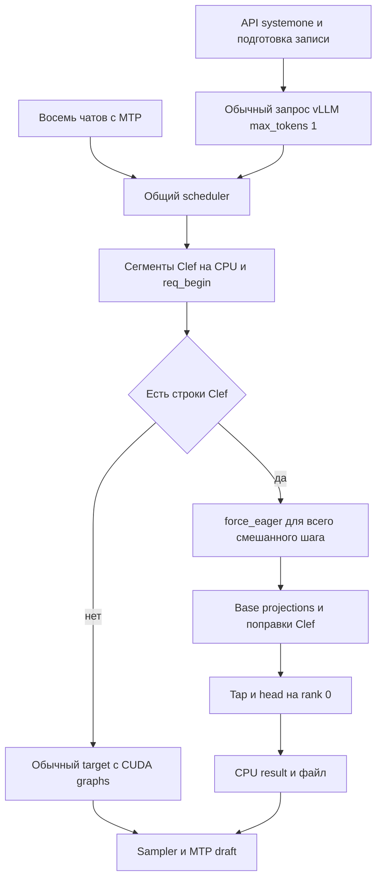

# Интеграция Clef в графы vLLM для ровного decode при C8

Дата: 28 октября 2026 года. Рабочая копия: `/home/alex/devpack_sm70_20261022/vllm-sm70`, HEAD `963896f7387f354a00cbeda853a56e1bf7388ede` с локальными изменениями. Основание — ревизия исходников, конфигурации, существующих замеров и журналов. Код сервиса не менялся, новые нагрузочные прогоны на рабочих GPU не запускались.

## Вывод и границы задачи

Встроить поправки Clef в общий проход модели и захватывать их CUDA-графами технически возможно. Текущая архитектура специально запрещает графы для любого шага с Clef. Снятие запрета без переработки маршрутизации нарушит корректность: CPU-ветвления, указатели и размеры сегментов зафиксируются при capture.

Для ровного decode рекомендуется не один монолитный граф «всё включая голову», а три связанных изменения: поправки Clef в графе target forward, асинхронная подготовка и выдача результатов головы, планирование коротких ограниченных по времени смешанных шагов. Граф уменьшает накладные расходы запуска; он не устраняет вычисления префилла, encoder и классификационной головы.

Основной рассматриваемый сценарий — восемь одновременно декодирующих чатов и фоновый поток `/v1/systemone`. Если C8 означает восемь запросов всего, включая Clef, требования к состояниям и бюджетам будут мягче. Если Clef вообще не поступает, обычный decode уже использует графы, и добавление узлов Clef в чистый граф не обещает улучшения.

Сопутствующий документ: [Ревизия памяти vLLM](VLLM_MEMORY_AUDIT_2026-10-28.md). Снимок хешей и выбранных доказательств: [evidence.json](CLEF_VLLM_GRAPH_ANALYSIS_2026-10-28.evidence.json).

## Что именно означает слияние

| Вариант | Оценка |
| --- | --- |
| Поправка Clef как GPU-операции внутри target forward | Рекомендуется; сохраняет одну базовую модель и маршрутизацию строк |
| Захват этих операций вместе с частями или всем target forward | Возможен после замены CPU-сегментов на постоянные device inputs |
| Kernel fusion базового GEMM и low rank поправки | Отдельная последующая оптимизация; сложнее и не обязательна для первого результата |
| Сложить поправку с весами модели заранее | Не подходит для одновременных ABL-чатов и Clef на одном наборе весов |
| Весь forward, sampler, MTP и голова одним CUDA-графом | Высокая сложность и риск памяти; не первый этап |
| Один общий сервис с несколькими ограниченными семействами графов | Предпочтительная архитектура |

Clef — не только стандартная LoRA. В `sm70/integrations/vllm_sm70/clef/clef_sborka.py` поправка объединяет обратную аблитерацию ранга 1 в out/down слоёв 2–63, LoRA ранга 256 в 40–63 и плотную разницу in_proj_a/b. Ранги для некоторых модулей объединены и дополнены до 264. Row-parallel поправка добавляется до штатного all reduce; перенос после него изменит TP-семантику. Простая замена на механизм native LoRA требует отдельной реализации этой композиции и плотной BA-поправки.

При слиянии с int8-весами нужны два разных поведения строк: обычные чаты должны продолжать видеть ABL, Clef — исправленную модель. Один merged weight изменит чаты, два набора весов увеличат память и потребуют маршрутизации GEMM. Requantization merged weights также изменит численный результат. Для текущих 32 ГБ GPU это менее подходящий старт, чем условная поправка на GPU.

## Фактический путь исполнения

Пути исходников в следующих разделах относительно рабочей копии, номера строк соответствуют проверенному состоянию.



`fa2sm70_clef.py:801–814` создаёт SamplingParams с max_tokens=1 и отправляет запрос в тот же engine. Входная подготовка ограничена admission semaphore, одновременные активные записи — `_R`, в конфигурации R=4. C8 для чатов не означает, что надо увеличить R Clef до восьми.

`fa2sm70_clef.py:379–431` после обновления runner строит CPU-массив сегментов `(row0, rows, slot, pos0, fin)`. Здесь же ведутся слоты, контроль целостности промпта и обработка вытеснения.

В `:485–488` при наличии сегментов принудительно задаётся `force_eager=True`. В `:490–502` CPU-сегменты передаются расширению, `_АКТИВЕН` включается только вокруг target forward, после чего выполняется tap и публикация результата.

`clef.cu:500–518` превращает сегменты в `std::vector<Seg>` и меняет CPU-состояние Engine. В `:522–575` C++ обходит этот vector, вычисляет CPU-адреса и размеры для cuBLAS GEMM. Разбиение диапазона зависит от текущих сегментов. `delta_keyed` ищет номер слоя по указателям весов.

Нынешние функции hook могут вызываться внутри opaque custom ops, но это не делает их replay динамическим. При обычном capture фиксируется только GPU-работа, поставленная в поток во время capture. Нужные значения должны поступать через постоянные device buffers. Это соответствует [правилам CUDA Graphs в PyTorch](https://docs.pytorch.org/docs/stable/notes/cuda.html#cuda-graphs).

## Источники неровности decode

### Весь смешанный target шаг теряет графы

Строки чатового decode и Clef идут вместе, но флаг force_eager относится ко всему запуску. Возникает переключение между двумя путями: быстрый граф для однородного decode и запуск множества операций на CPU для смешанного шага. В C++ поправке есть циклы по сегментам и операциям, в базовой модели также меняются пути prefill/decode.

Это подтверждённая архитектурная причина дополнительного overhead, но её доля в p99 inter-token latency ещё не измерена. Существующие средние tokens/s не позволяют приписать всю неровность только этому флагу.

### Размер смешанного шага намного больше C8 decode

MTP_K=4 означает до 5 target токенов на декодирующий запрос. Чистый C8 даёт 40 target токенов. Добавление, например, 512 строк Clef даёт 552 токена и неоднородные query lengths; 8K prefill даёт ещё больший объём.

Текущие capture sizes заканчиваются на 40. Проверка uniform decode в `gpu_model_runner.py:3833–3876` и dispatch в `:3880–3935` не превращают смешанный prefill в однородный decode. Даже после снятия Clef force_eager такой пакет нельзя исполнить существующим full graph на 40 токенов. Нельзя подменять uniform=True: в дереве уже есть исправление повреждения GDN-состояний при ложном определении prefill как speculative decode.

Если Clef остаётся в длинном mixed step, чат получит следующий результат только после завершения необходимого прохода этого шага. Граф уберёт launch overhead, но не вычислительную задержку. Для ровности нужен отдельный бюджет Clef prefill, а не только новые graph sizes.

### Подготовка запроса синхронизирует рабочий поток

В `clef.cu:691–714` req_begin выполняет H2D для span metadata и lexical vectors, memset накопителей, затем `cudaStreamSynchronize(st)`. Эта операция вызывается на рабочем ранге при приёме Clef. Причина в коде — время жизни временных CPU-тензоров.

Это можно переработать без изменения математики: постоянные pinned staging buffers, H2D на подготовительном потоке, событие готовности и wait на устройстве перед использованием слота. До завершения H2D нельзя переиспользовать host buffer. Отдельная CPU-стадия lexical mean и CRC также остаётся работой на критическом worker-пути, пока её не перенести в подготовку/кеш.

### Голова Clef выполняется после forward на rank 0

`fa2sm70_clef.py:434–452` вызывает tap и затем получает результат через `.cpu().tolist()`, записывает JSON. Это находится внутри обёртки `_model_forward`, до её возврата раннеру. Получение logits на CPU заставляет дождаться GPU-результата; файловый вывод добавляет работу на CPU.

`clef.cu:869–907` в конце записи запускает `head_run`. Голова выполняется на текущем потоке rank 0, в том числе внимание по всей накопленной памяти записи. В `:736–754` число проходов зависит от N с шагом E.chunk. Следующий общий TP-проход может ждать rank 0 на коллективной операции, даже если rank 1 уже готов.

Длительность этой асимметрии требует трассы обоих рангов. Она не исчезнет только от захвата основной модели.

### Веса адаптера уже резидентны, но веса головы продолжают подкачиваться

Лог текущего запуска сообщает `streamed=0` для поправок. След Clef — 841 МиБ на rank 1 и 1248 МиБ на rank 0. Поэтому повторная H2D-подкачка LoRA слоёв не является текущей причиной: STREAM_FROM=1000 уже держит их на GPU.

Однако `clef_golova.py` делит голову на девять ступеней в pinned CPU memory. `clef.cu:623–626` копирует каждую ступень в один GPU stage buffer; `head_run` вызывает это для ступеней 0–8 на каждый результат.

Расчёт по заголовку реального `joint_head_fp16.safetensors` с тем же 128-element alignment:

| Ступени | Объём fp16 |
| --- | --- |
| S0 | 30,000 МиБ |
| S1 и S2 | по 24,029 МиБ |
| S3 | 20,010 МиБ |
| S4–S7 | по 32,037 МиБ |
| S8 | 8,012 МиБ |
| Всего на одну голову | 234,229 МиБ |

Текущий stage buffer — 32,037 МиБ. Полная резидентность ступеней потребует дополнительно примерно 202,192 МиБ только на rank 0, без новых graph pools и scratch. Это расчёт объёма, не измерение времени PCIe. При уже наблюдавшемся OOM добавлять эту память без освобождения бюджета нельзя.

Захват головы с теми же H2D узлами сохранит все 234 МиБ копий. Сам по себе граф не превращает host weights в резидентные GPU weights.

### MTP и выдача токенов сами дают переменную гранулярность

На одном шаге принимается разное число speculative tokens. На стороне клиента SSE-чанк может содержать сразу несколько токенов. Существующий `sm80_work/bench/e2e_batch.py` назначает всем токенам чанка одну метку времени и считает средний установившийся throughput, исключая стартовые префиллы. Это полезно для скорости, но недостаточно для анализа pauses, p95/p99 ITL и влияния Clef.

Видимая «скорость по секундам» зависит также от принятия MTP, flush/network и состава запросов. Нужны одновременно server step latency и клиентские межчанковые интервалы, а не только счётчик токенов.

## Рекомендуемая архитектура поправок в графе

### Постоянный GPU контекст шага

Создать явный StepContext для каждого безопасно переиспользуемого набора буферов:

```text
clef_row_indices[Bc]       индекс строки в общем packed batch
clef_row_valid[Bc]         padding и маска реальных строк
clef_request_slot[Bc]      ячейка накопления головы
clef_request_position[Bc]  позиция внутри записи
request_epoch[R]           поколение слота против устаревшего результата
row_counts и финализация   device metadata для tap
scratch                    заранее выделенные gather/GEMM/scatter буферы
```

Bc — размер корзины Clef-строк, не максимальная длина записи. R=4 — количество записей, а не количество строк. CPU scheduler готовит маленький descriptor и асинхронно копирует его в стабильные GPU inputs; ни req_id, ни key результата, ни pos0 не должны создавать новый граф.

Для каждого custom op данные StepContext должны быть явными входами или частью проверенного устойчивого graph context. Нельзя полагаться на replay Python `_АКТИВЕН` или обход `std::vector<Seg>`. Нельзя читать device counts через item(), чтобы определить число GEMM в захватываемой области.

### Все Clef строки используют одну поправку

Все одновременные записи `/v1/systemone` используют тот же адаптер. Поэтому можно объединить их выбранные строки в один компактный набор на проекцию независимо от слотов головы:

```text
base GEMM на общем batch
  → masked gather x и текущего y только для Clef строк
  → существующая последовательность shrink / expand / dense
  → masked scatter corrected y в те же строки
  → штатный all reduce для row parallel
```

Это позволяет избежать отдельной цепочки cuBLAS на каждую запись. Для базовых строк scatter не выполняется; их значения должны оставаться побитово прежними. Для padding используются корректные нулевые данные и запрет scatter, а не выход за границу либо неверный slot.

Для сохранения текущего fp16 rounding нужно учитывать, что существующий expand выполняется с beta=1 прямо в y. Вариант «сначала вычислить отдельную delta, потом y+=delta» может изменить округления. Объединение сегментов в один GEMM тоже может поменять алгоритм cuBLAS и численный результат. Эти изменения требуют отдельной сверки; обещать побитовое совпадение только по алгебре нельзя.

Первый слой, не имеющий поправки, должен идти по безопасному fp16 пути с ограниченными активациями. Отсутствие W8 не должно заставлять весь пакет выполнять полную проекцию и сведение, как при последнем OOM.

### Ограниченные семейства графов

Сохранить чистый decode как отдельный быстрый граф без лишних Clef GEMM. Для смешанных шагов подготовить небольшой набор корзин total tokens и Bc. Например, 128/256/512/1024 — лишь кандидаты для стенда, не готовая рекомендуемая конфигурация.

Сначала реализовать Clef внутри graph-safe участков target, используя piecewise capture там, где attention/GDN metadata ещё динамические. Затем оценить возможность полного mixed forward. Не форсировать full graph на неподдерживаемых формах и не добавлять все формы до 8192 без учёта памяти.

Ключ графа включает только структурные параметры: graph family, padded batch sizes, необходимые варианты attention/GDN и Clef bucket. Значения descriptor меняются без recapture. Число графов и их memory budget ограничены; прогрев выполняется до обслуживания измеряемого потока, не при каждом новом req_id или token position.

### MTP остаётся отдельным этапом

Текущий hook исключает `mtp` из binding, а `_АКТИВЕН` охватывает только target forward. Эту границу нужно сохранить: Clef не должен попадать в draft model, оставшиеся позиции, slot mapping или состояние обычных чатов.

На первом этапе не объединять target, sampling и MTP loop в один граф. Существующие кеши MTP уже имеют много ключей и сложную историю управления постоянными буферами. Слияние добавит переменные acceptance counts, compaction и mapping между target/draft, не решая главную проблему длинного префилла.

## Голова вне критического пути decode

Предпочтительный следующий шаг — tap после target с GPU-событием и отложенная head job на rank 0. Она использует свой stream и явно отделённый workspace. После завершения головы результат копируется в pinned output, completion event проверяется неблокирующе, JSON/IPC выдаётся вне model runner.

Сейчас E.mem/E.span/E.glob разделены по R, но E.ws_* и E.stage_buf общие для всех запросов. Поэтому запускать несколько голов параллельно существующим кодом нельзя: они перезапишут общий scratch. Допустим последовательный head queue с отдельным workspace от выполняющегося tap, либо отдельные workspaces при достаточной памяти.

Слот нельзя освобождать при finished_req_ids, пока head не закончила читать накопители. Нужны состояния FREE → PREPARING → ACCUMULATING → HEAD_PENDING → RESULT_PENDING → FREE и epoch на каждое повторное использование. Preemption, cancel и повторный prefill должны отменять или завершать старую job без смешивания накоплений.

Захват головы в собственный граф возможен по ограниченным структурным корзинам Qn/Qo/N. При padding N надо маскировать внимание и сохранять точную нормировку softmax. При padding вопросов и вариантов нужны корректные qoff, qidx и маски; простое заполнение нулями изменит семантику.

На первом этапе лучше графировать ограниченные куски головы, оставив длинный обход памяти делимым на задания. Один огромный head graph без точек планирования может сам ухудшить хвост задержек.

Низкий приоритет stream не гарантирует ровный decode и не прерывает уже исполняющееся ядро. Нужно ограничивать длительность head jobs и измерять конкуренцию за SM/HBM. Это соответствует [документации NVIDIA о приоритетах потоков](https://docs.nvidia.com/cuda/archive/12.9.1/pdf/CUDA_C_Programming_Guide.pdf).

## Планировщик для ровного C8

В `vllm/v1/core/sched/scheduler.py:342–383` running requests обслуживаются в порядке списка, потребляя общий token budget. У Clef нет отдельного лимита GPU-времени; long_prefill_token_threshold — общий порог, а не SLA конкретного класса запросов.

Для смешанного режима нужен бюджет Clef по шагу и положительная гарантированная доля обслуживания, чтобы Clef не голодал. Decode requests должны получать свой очередной шаг при допустимой ёмкости кешей. Не достаточно уменьшить один глобальный max_num_batched_tokens: такой параметр затронет обычные префиллы и другие workload.

Вариант A — короткие mixed steps: восемь decode requests плюс ограниченный Clef chunk, все поправки graph-safe. Выгода — общий GEMM; сложность — mixed GDN/attention metadata и увеличение общего шага.

Вариант B — чередование: чистый decode graph C8, затем ограниченный Clef prefill slice, затем снова decode. Выгода — сохраняется уже проверенный decode graph; цена — отдельный проход весов и возможное снижение суммарного throughput. Слайс Clef всё равно должен быть достаточно коротким, иначе между decode шагами останутся большие паузы.

Оба варианта должны сравниться по p99 ITL и обслуживанию Clef при одинаковом входном потоке. Выбор только по суммарным tokens/s не отвечает цели пользователя.

Префиллы изображений включают общий visual encoder до target. Граф поправок Clef не ускорит и не изолирует encoder. Для image workload нужны отдельные ограничения encoder budget и отдельные измерения.

## Бюджет памяти и ограничения C8

Текущие GPU уже испытывали OOM. Возможность работы базового C8 ранее достигалась перераспределением GDN blocks до 49; это не доказательство наличия запаса для восьми чатов, четырёх длинных Clef и новых графов одновременно. Оценивать нужно отдельно GDN states, attention KV pages и encoder cache.

`kv_cache_manager.py:452–458` уже исключает speculative reserve для max_tokens=1 при включённом NO_SPEC_BLOCKS_MAXTOK1; это важно сохранить. Реальное количество блоков на запрос определяется менеджерами и моментом scheduler; одной формулы C×(1+k) недостаточно для всего mixed workload.

В резерв нового решения входят:

- graph-private pools и постоянные inputs каждой разрешённой корзины;
- gather/scatter scratch и fp16 Clef outputs;
- отдельный tap/head workspace и буферы асинхронного приёма/выдачи;
- при резидентной голове дополнительно около 202,2 МиБ на rank 0;
- стабильный запас под неквантованный слой 0 и fallback all reduce.

Из предыдущей ревизии: только ненужный all_gather buffer при P2P может занимать 121,25 МиБ. Его устранение не покроет автоматически все потребности резидентной головы и новых графов. KV задан вручную, gpu_memory_utilization не пересчитает его бюджет. Все изменения должны начинаться с измерения пика на обоих рангах.

Общие graph pools допускают переиспользование памяти только при корректных зависимостях и времени жизни. Нельзя позволять независимой head job и target graph писать в одинаковую память. Правила lifetime и sharing описаны в [PyTorch Graph memory management](https://docs.pytorch.org/docs/stable/notes/cuda.html#graph-memory-management).

## Что измерять до реализации

Нужна короткая трасса существующего пути на отдельном стенде с NVTX для admission, req_begin, encoder, target, delta, tap, head, result copy, sampling, MTP и TP collectives. В marker шага — число decode requests, Clef rows, total tokens, graph mode и bucket. Не включать cuda.synchronize на каждом шаге в обычный benchmark.

Предыдущие внутренние замеры `sm80_work/PLAN_PREFILL_CLEF.md` сообщают около 505–510 ток/с для C8 после изменения GDN pools; это исторический throughput, не измерение p99 на сегодняшней смешанной нагрузке. Документ также показывает существенную долю host launch overhead до оптимизаций MTP. Эти результаты обосновывают эксперимент, но не численный прогноз ускорения Clef graphs.

Оценка шага:

```text
T_step = CPU preparation и submission
       + target base + Clef delta + TP synchronization
       + blocking tap/head/result work
       + sampling и MTP
       + resource contention и ожидание scheduler
```

Слагаемые могут перекрываться, поэтому складывать независимые wall-clock timers без трассы нельзя. Доля launch overhead задаёт предел выигрыша от capture при неизменных вычислениях. Пока эта доля не измерена для C8+Clef, обещать конкретный процент или постоянный tokens/s нельзя.

## Матрица экспериментов

| Вариант | Что меняется | Какой эффект проверяет |
| --- | --- | --- |
| A | Текущая реализация | Базовая линия |
| B | Только асинхронные req_begin и result delivery | Блокировки worker CPU и stream sync |
| C | Head queue с отдельным workspace | Хвост финализации и перекос рангов |
| D | Graph-safe delta и piecewise mixed forward | Launch overhead target |
| E | Ограниченный Clef budget плюс D | Ровность под длительной нагрузкой |
| F | Чередование pure decode и Clef slices | Альтернатива mixed graph |
| G | Резидентная голова либо её подграфы | Цена H2D и dispatch головы |

Для каждого варианта: чистый C8; C8 плюс Clef text длиной около 2K/8K/34K; Clef concurrency 1 и 4; burst arrivals и равномерный поток; изображения отдельно; длинные chat contexts отдельно. Использовать один и тот же набор входов и темп подачи, прогретые графы и повторения с чередованием порядка вариантов. Изолировать влияние стороннего обучения и CPU memory pressure.

Собирать по каждому чату p50/p95/p99 межчанковых интервалов, максимальную паузу и распределение tokens per chunk; server step p50/p95/p99; accepted tokens per MTP step; graph hit/miss/capture; TTFT; aggregate и per-request throughput; Clef latency/queue wait/throughput; VRAM allocated/reserved/private pools/direct allocations. Нулевые «межтокенные интервалы» внутри одного SSE-чанка не считать доказательством ровности.

Для длительного soak: не менее нескольких часов на разнообразных контекстах, проверка насыщения числа графов, памяти и очереди головы. Критерии p99 и допустимой потери Clef throughput выбрать до сравнения, исходя из пользовательского SLA. В качестве экспериментального ориентира можно сравнивать p99 mixed с baseline pure C8, но это не обещание достижимого SLA на тех же ресурсах.

## Проверки корректности

1. Обычные строки не меняются при перемещении Clef-строк в пачке; отдельно проверить first/last/middle, padding и ноль активных строк.
2. Clef logits сверяются с нынешним eager-путём на нескольких размерах и типах вопросов, текстах и изображениях. Проверять численный дрейф и решения около порога, а не только процент совпавших классов.
3. Один запрос целиком и в разных chunk boundaries: нет повторного накопления span/global и потери hidden states; preemption/restart/cancel/slot reuse с epoch.
4. TP-ранги выбирают одинаковый graph family и выполняют коллективные операции в одинаковом порядке. Delta row-parallel добавляется до all reduce.
5. MTP не получает Clef correction или его row map; cache salt и запрет чтения prefix cache Clef сохраняются.
6. Никакой ложной маркировки mixed prefill как uniform speculative decode; сохранить UNIFORM_PREFILL_FIX и GDN metadata fixes.
7. Повтор графа после смены состава C8→C1→C8 и нескольких корзин: все inputs и scratch живы, outputs не перезаписаны shared pool раньше потребления.
8. Head queue не использует общий scratch одновременно; finished request не освобождает слот до completion головы; rank 0 result copy не блокирует возврат обычных токенов.
9. Ошибка capture очищает временные ресурсы, не оставляет растущие клоны, fallback сохраняет математику и порядок TP.

## Поэтапное решение

Первый этап — измерить критический путь и исправить нехватку запаса памяти. Параллельно подготовить descriptor, pinned buffers и неблокирующую выдачу результатов без изменения математики.

Второй этап — вынести голову в управляемую очередь с явным lifetime слотов и ограничением времени jobs. Это устраняет отдельный источник задержек, который общий target graph не покрывает.

Третий этап — реализовать graph-safe поправки через compact Clef rows, сохранив отдельный pure decode graph. Начать с piecewise mixed forward и ограниченного числа корзин. Испытать C8 с контролируемыми Clef chunks и сравнить с чередованием отдельных проходов.

Четвёртый этап — по измеренному профилю выбирать kernel fusion, резидентность головы и её подграфы. Полный монолит target+MTP+head рассматривать только если остающийся overhead оправдывает дополнительную сложность.

Итоговое решение по возможности — да для поправок Clef в target graph; условно для полного mixed forward, пока не доказана graph-safety attention/GDN на выбранных формах; не рекомендуется начинать с монолитного графа всей обработки. Для ровного decode C8 графирование должно сопровождаться ограничением prefill/head work и устранением синхронизаций на worker-пути.
